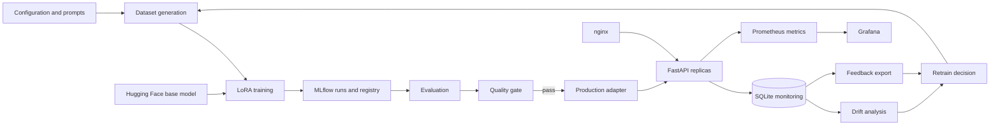

# System Architecture

## Logical architecture



## Proposed repository structure

```text
.github/workflows/       CI/CD workflows
configs/                 Central YAML configuration
prompts/                 Versioned system prompts
src/
  data/                  Dataset generation
  monitor/               SQLite store, drift and triggers
  serve/                 FastAPI application and browser UI
  utils/                 Configuration, logging, prompts and PII
  evaluate.py            Candidate evaluation
  gate.py                Quality-gate decision logic
  model_io.py            Model resolution and loading
  registry.py            MLflow registry operations
  train.py               LoRA fine-tuning
scripts/                 Operational automation
tests/                   Unit and integration tests
k8s/                     Kubernetes manifests
monitoring/              Prometheus and Grafana configuration
docs/                    Engineering documentation
nginx/                   Load-balancer configuration
models/                  Generated, non-source artifacts
mlruns/                  Generated MLflow artifacts
reports/                 Generated reports
Dockerfile
Makefile
docker-compose.yml
```

## Component contracts

### Configuration contract

`src/llmops/config.py` loads `configs/config.yaml` and permits runtime overrides through `LLMOPS_` environment variables. Environment values override YAML values. Relative data and prompt directories resolve from the project root; explicitly configured absolute paths are preserved.

### Dataset contract

Dataset rows use the following logical fields:

```json
{
  "id": "string",
  "topic": "string",
  "instruction": "string",
  "response": "string",
  "keywords": ["string"]
}
```

The contract is JSONL-based and is shared by training, evaluation and traffic simulation. `src/llmops/data/dataset.py` generates rows deterministically from a seed, reads and writes JSONL, and splits rows into disjoint train and validation sets.

### Prompt contract

Versioned system prompts live in `prompts/v<number>.txt`. `src/llmops/utils/prompts.py` discovers and loads prompt versions and builds system/user chat-message pairs. A missing or invalid requested version raises a clear error rather than silently selecting a different prompt.

### Backend contract

`LLMBackend.generate(prompt, max_new_tokens, temperature)` returns a value containing:

- generated text;
- generated-token count;
- generation duration;
- input-token count.

### API contract

Generation responses identify the request ID, model version and prompt version. Feedback references an existing request ID.

### Registry contract

The registry stores LoRA adapter artifacts rather than full base weights. `candidate` and `production` are logical aliases. A source resolver returns the adapter source kind, adapter path, model label, run ID, prompt version and tags.

### Monitoring contract

Persisted request prompts are PII-masked before storage. Drift consumes the masked prompts; feedback exports include the original masked prompt and response associated with the request ID.

## Runtime sequences

### Training sequence

```text
load configuration
→ load prompt
→ load train/validation JSONL
→ download/load base model
→ apply LoRA
→ tokenize and mask labels
→ run Trainer
→ save adapter
→ create/update MLflow run
→ register adapter
→ assign candidate alias
```

### Evaluation and promotion sequence

```text
resolve candidate adapter
→ load validation rows
→ generate candidate responses
→ calculate metrics
→ write reports/eval.json
→ apply smoke/full gate thresholds
→ compare current production, where present
→ pass: alias candidate as production and copy adapter locally
→ fail: preserve production and return non-zero
```

### Request sequence

```text
HTTP request
→ schema validation
→ model readiness check
→ generation
→ response metrics
→ masked request persistence
→ JSON response with request ID
```

### Monitoring sequence

```text
generated requests and feedback
→ SQLite
→ drift calculation
→ JSON and HTML reports
→ Prometheus drift gauge
→ Grafana
→ retrain decision
→ feedback export and merge
→ retraining pipeline
```

## Deployment topology

### Local development

```text
Developer terminal
  FastAPI/Uvicorn on port 8000
  optional local MLflow SQLite
```

### Docker Compose

```text
nginx :8080
  → API replicas :8000
MLflow :5000
Prometheus :9090
Grafana :3000
```

### Kubernetes

```text
Service
  → Deployment replicas
      → application container
      → readiness/liveness probes
      → CPU HPA
```

## Planned non-functional requirements

- Deterministic unit behavior without model downloads.
- Model training and model serving must be separable at the test boundary.
- Readiness must represent model availability, not process liveness.
- Monitoring failures must be isolated from response generation where possible.
- Runtime containers should execute as a non-root user.
- CI should validate code before running expensive model jobs.
- Deployment documentation must state which persistence components are demonstrative and which require replacement for production.

## Boundary decisions requiring integration tests

1. MLflow registry artifact path resolution from a host to a container.
2. Model loading from registry, local production adapter and base model.
3. API behavior with and without a loaded model.
4. SQLite concurrency between API replicas.
5. Drift JSON consumption by Prometheus refresh logic.
6. Feedback ID matching and export.
7. Production promotion and container startup from a downloaded artifact.
8. Kubernetes readiness and restart behavior.
